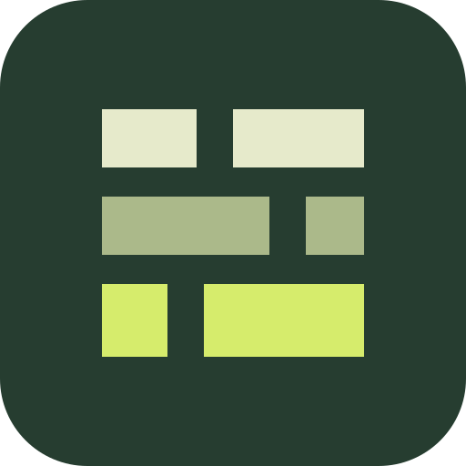
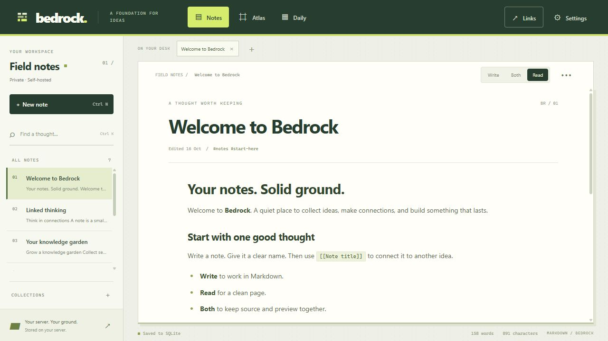
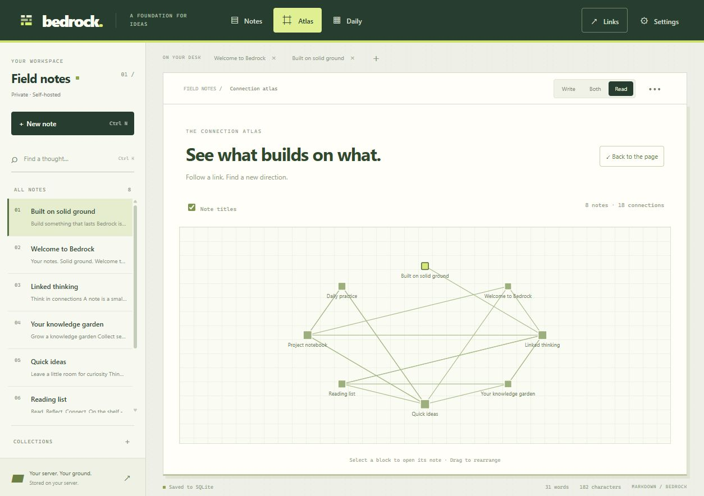
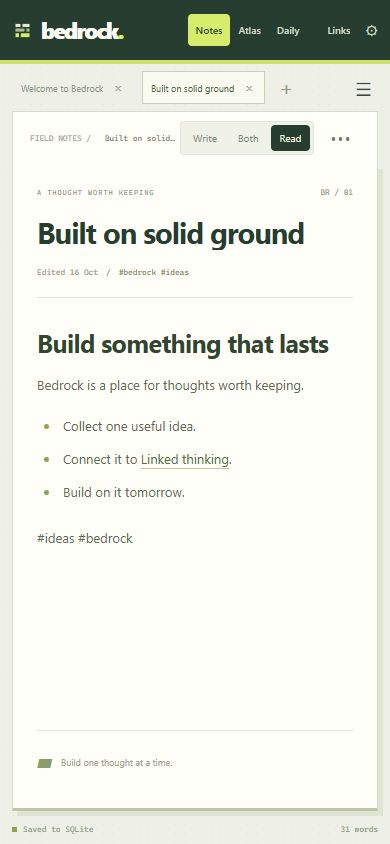

<div align="center">
  
  <h1>Bedrock</h1>
  <p><strong>Your notes. Solid ground.</strong></p>
  <p>A self-hosted Markdown notebook with linked notes, backlinks, and a connection atlas.<br>One Rust server. Your browser, desktop, or phone.</p>

  [](https://github.com/Manicharan01/bedrock-notes/actions/workflows/ci.yaml)
  [](https://github.com/Manicharan01/bedrock-notes/releases/latest)
  [](LICENSE)

  [Download](https://github.com/Manicharan01/bedrock-notes/releases/latest) · [Get started](#get-started) · [Documentation](docs/README.md) · [Contribute](CONTRIBUTING.md)
</div>



## A foundation for connected ideas

- **Write in Markdown.** Switch between Write, Both, and Read; use tables, task lists, and fenced code blocks.
- **Build a web of notes.** Type `[[Note title]]`, follow backlinks, and explore square nodes in the Atlas. Rename a note and its resolved incoming links follow.
- **Find a thought.** Search notes, filter tags, browse headings, or open today's daily note.
- **Own the server.** Notes live in SQLite behind a Rust/Axum API. Docker Compose and HTTPS proxy examples are included. No cloud account, telemetry SDK, or AI service is required.
- **Bring your devices.** Use the web/PWA or the native Windows and Android clients. Linux source is included.
- **Keep control of edits.** Revision checks prevent silent overwrites; local draft recovery and Markdown/JSON export help protect your work.

<details>
<summary>See the Atlas and phone layout</summary>




</details>

## Get started

### Try it on your computer

Download the **Windows server ZIP** from [Releases](https://github.com/Manicharan01/bedrock-notes/releases/latest), extract it, and double-click `Start-local.cmd`. Open **http://127.0.0.1:4173**. The web interface is built into the server; it does not need Node.js.

With Rust 1.85+ and a C toolchain, you can also start from source:

```sh
git clone https://github.com/Manicharan01/bedrock-notes.git
cd bedrock-notes
cargo run --locked --release -- --port 4173
```

Local mode listens on loopback without an access key. For other devices, follow the [self-hosting guide](docs/self-hosting.md) to set an HTTPS public URL, generate a private key, and configure a reverse proxy.

### Connect your devices

Open your server's HTTPS address in a browser, or enter that address and your access key in a native client. Native clients connect to your server; they do not run a separate server on your phone.

| Platform | Available | Notes |
|---|---|---|
| Web / PWA | Included in the server | Install through a supported browser on HTTPS |
| Windows x64 | Portable client and server ZIPs | Client requires WebView2; binaries are unsigned |
| Android ARM64 | Test APK | Android 7/API 24+; debug-signed sideload build |
| Linux | Server and native client source | DEB/AppImage releases are not currently provided |

**Bedrock is an early personal-notes app.** It uses one shared notebook/access key. It needs the server to load and save; local drafts are recovery copies, not a complete offline replica. It does not offer individual accounts, end-to-end encryption, attachments, plugins, or automatic text merging. [Read the data and security model](docs/architecture.md#data-and-security-model).

## Documentation

| Guide | Covers |
|---|---|
| [User guide](docs/user-guide.md) | Writing, links, tags, daily notes, keyboard shortcuts, import and export |
| [Self-hosting](docs/self-hosting.md) | Docker, HTTPS, environment variables, native origins, backup and upgrades |
| [Troubleshooting](docs/troubleshooting.md) | Connection problems, session expiry, conflicts, recovery, and platform issues |
| [Architecture](docs/architecture.md) | Rust API, SQLite, client state, security boundaries, and source map |
| [Development](docs/development.md) | Local setup, checks, native builds, CI and releases |
| [API reference](API.md) | Endpoints, authentication, commands, errors and limits |
| [Verification](VERIFICATION.md) | Tests actually run and platform limitations |
| [Changelog](CHANGELOG.md) | Changes and upgrade compatibility |

Existing Lattice notebooks keep their identity, database, drafts, and backup format. Legacy environment variables and client headers remain accepted. [Upgrade notes](docs/self-hosting.md#updating-from-lattice).

## Help build Bedrock

Bug reports, documentation fixes, accessibility improvements, and focused patches are welcome. Start with [Contributing](CONTRIBUTING.md), [open issues](https://github.com/Manicharan01/bedrock-notes/issues), or a [feature proposal](https://github.com/Manicharan01/bedrock-notes/issues/new/choose). Report security issues [privately](SECURITY.md).

Bedrock is [MIT licensed](LICENSE); dependency notices are in [THIRD-PARTY-NOTICES.md](THIRD-PARTY-NOTICES.md). The name is inspired by Minecraft's bedrock layer; this project is independent and is not affiliated with Mojang, Microsoft, or Obsidian. The interface and layered stone mark are original.
