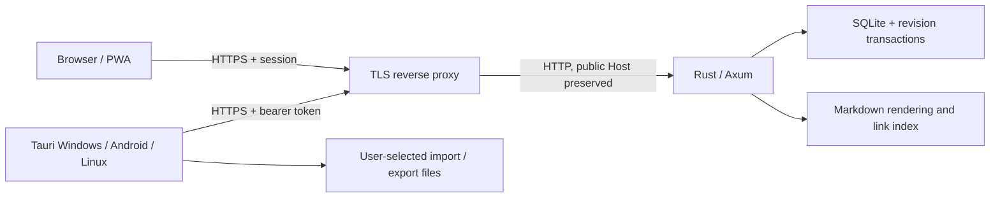

# Architecture

Bedrock has one authoritative Rust server and a shared browser interface. Tauri packages that interface for desktop and Android, adding native file dialogs. There is no AI runtime or cloud dependency.

## Ownership and save flow

1. The server opens SQLite and exposes a durable notebook UUID and revision.
2. Clients separate confirmed snapshots from unsaved drafts. Writes are serialized in the client.
3. Every mutation includes its expected UUID and revision. An immediate SQLite transaction accepts one matching writer, increments the revision, and returns an authoritative snapshot.
4. A stale writer receives HTTP 409. Its draft remains local; the user exports or discards it before reloading. There is no automatic text merge.
5. Clean clients check the revision every 15 seconds and on focus. A refresh never overwrites a draft that arrived during the request.

Rust parses Markdown, resolves links, builds backlinks and graph edges, computes heading offsets, and validates limits. JavaScript presents that data and keeps UI/draft state. Graph coordinates are presentation state and are not saved as notebook content.

## Data and security model

| Boundary | Behavior |
|---|---|
| Authentication | One server key; random bearer sessions stored hashed in memory; 12-hour expiry and revocation on restart/sign-out |
| Browser session | HttpOnly, SameSite=Strict cookie; Secure for an HTTPS public URL |
| Native session | Bearer token in memory; the access key is not put in localStorage |
| Browser origins | Exact allowlist plus required client header; no wildcard CORS; Host must match public authority |
| Storage | SQLite WAL, FULL synchronous writes, parameterized SQL, transactional mutations |
| Draft recovery | Plaintext localStorage, scoped to server origin and notebook UUID |
| PWA cache | App shell only; no notebook API responses, sessions, or third-party resources |
| Rendering | Server-controlled Markdown rendering; raw HTML is not executed; restricted URLs and CSP |
| Native files | Files selected through native open/save dialogs |

The server administrator can read the database. Bedrock does not implement end-to-end encryption, individual accounts, roles, plugins, attachments, or a full offline replica. Use it personally or with a trusted group sharing one key. TLS terminates at your proxy; the upstream HTTP port belongs on a private or loopback network.

See [API limits](../API.md), [security reporting](../SECURITY.md), and [actual verification](../VERIFICATION.md). No security audit is claimed.

## Source map

| Path | Responsibility |
|---|---|
| `src/main.rs`, `src/config.rs` | Options, startup validation, origins and shutdown |
| `src/auth.rs`, `src/http.rs` | Sessions, boundaries, HTTP API, embedded web assets |
| `src/store.rs`, `src/model.rs` | Schema, notebook identity, transactions, commands and validation |
| `src/markdown.rs` | Rendering, search, tags, wiki links, headings and backlinks |
| `web/client.mjs` | Serialized writes, revision handling and recovery |
| `web/connection.mjs` | Origin validation and authenticated transport |
| `web/app.mjs`, `web/style.css` | Interface, file actions, graph and responsive layouts |
| `native/` | Tauri wrappers, capabilities and Android project |
| `deploy/`, `compose.yaml`, `Dockerfile` | Self-hosting examples |
| `tests/`, `.github/workflows/` | Regressions, CI and optional package builds |

Historical names such as library `lattice`, native ID `org.lattice.notes`, cookie, and database filename intentionally stay stable so an update does not create a separate notebook or app installation.
